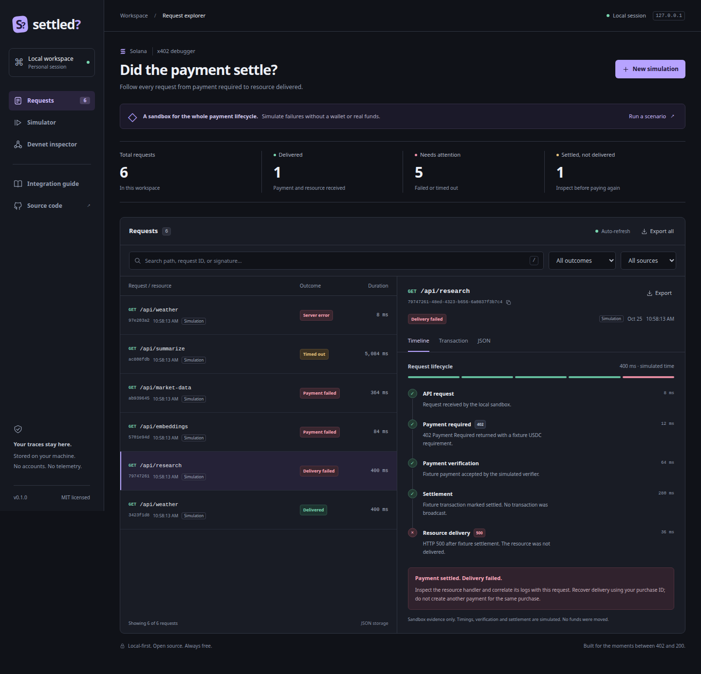
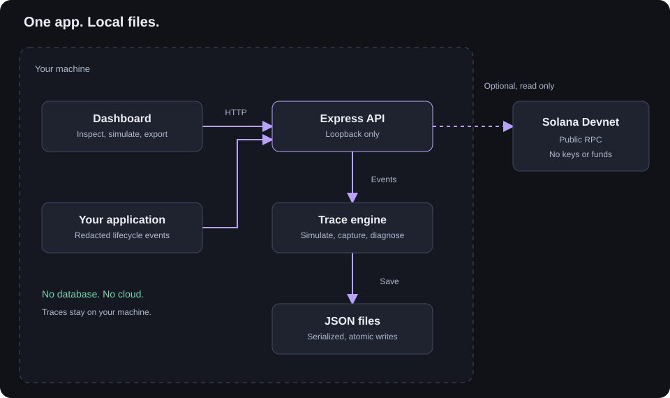

# Settled?

**A free, local-first x402 payment debugger for Solana. Find out whether a payment settled and why delivery failed.**



[](https://github.com/royalpinto007/settled/actions/workflows/ci.yml)
[](LICENSE)

## Run

Requires Node.js 22.18+ and npm.

```bash
git clone https://github.com/royalpinto007/settled.git
cd settled
npm install
npm run demo
```

Open **http://127.0.0.1:4402**. Choose **New simulation** to try a success, rejection, timeout or delivery failure. No wallet or funds needed.

## What you can do

- Trace requests, verification, settlement and delivery.
- Capture events from your app and export JSON.
- Inspect an existing Devnet transaction.

Data stays in local JSON files. No database, account, telemetry or paid API. Devnet checks report chain execution, not full x402 payment validity. This is a debugger, not a wallet or facilitator.

## How it works



**[Architecture and payment flow](docs/architecture.md)** · **[API guide](docs/api.md)** · **[Local setup](docs/local-setup.md)**

Architecture and API pages are also available from the dashboard, offline.

## Contribute

```bash
npm run check
npx playwright install chromium
npm run test:e2e
```

See [CONTRIBUTING.md](CONTRIBUTING.md). Licensed under [MIT](LICENSE). Not published to npm.

## Feedback

[Share what worked or got in your way](https://github.com/royalpinto007/settled/issues/new?template=feedback.yml). See [feedback status](docs/feedback.md) and [demo capture instructions](docs/demo.md).
