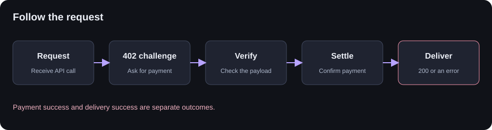

# Architecture

One Node.js process serves the dashboard and API. Traces stay in local JSON files. Only an explicit Devnet check contacts an external service.

## System

| Part           | Job                                                       |
| -------------- | --------------------------------------------------------- |
| Dashboard      | Browse traces, run simulations and export JSON            |
| Express API    | Validate incoming data and serve local pages              |
| Trace engine   | Simulate stages, derive outcomes and suggest next steps   |
| JSON store     | Queue writes, sync files and replace snapshots atomically |
| Devnet adapter | Read transaction status from the fixed public RPC         |

## Payment flow

Each trace follows five stages. A failed or timed-out stage stops later stages. A settled payment can still have a failed delivery.

- **Simulation:** fixture events and timings. No funds move.
- **Capture:** events reported by your app, not independently verified.
- **Devnet:** a separate chain observation, without invented API events.

The capture format currently assumes settlement before delivery. For other x402 flows, adapt the model before integrating.

## Boundaries

The app binds to loopback, rejects foreign browser origins, and accepts no keys or arbitrary RPC URLs. Storage holds up to 1,000 traces with one process per directory.

[API contract](api.md) · [Storage and setup](local-setup.md) · [Source map](#source-map)

## Source map

| File                  | Owns                                       |
| --------------------- | ------------------------------------------ |
| `src/domain/trace.ts` | Trace schemas, simulations and diagnostics |
| `src/adapters/`       | Local storage and Devnet RPC               |
| `src/app.ts`          | HTTP routes and access checks              |
| `src/server.ts`       | Startup and shutdown                       |
| `src/web/app.ts`      | Dashboard interactions                     |
