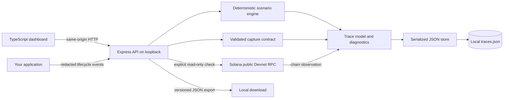

# Architecture

One local Node.js process serves the dashboard and JSON API. The dashboard makes same-origin requests. Simulation and capture require no network service. Only an explicit Devnet check makes an external request.

## Responsibilities

| Module                   | Responsibility                                                                       |
| ------------------------ | ------------------------------------------------------------------------------------ |
| `src/domain/trace.ts`    | Typed schemas, ordered stage contract, fixture simulations, outcomes and diagnostics |
| `src/adapters/store.ts`  | Single-process lock, validated disk format, serialized writes, atomic replace        |
| `src/adapters/devnet.ts` | Fixed public RPC, 8-second deadline, bounded response, schema validation             |
| `src/app.ts`             | Local access checks, strict HTTP validation, pagination, capture, export and errors  |
| `src/server.ts`          | Environment, storage lifecycle, demo seeding and graceful shutdown                   |
| `src/web/app.ts`         | Request selection, filtering, timeline, details, dialogs and exports                 |

## Evidence model

An immutable trace has a UUID, UTC capture timestamp, source, request metadata, optional payment metadata, events and optional transaction details. Amounts use strings of integer token base units. Event offsets and durations use integer milliseconds relative to request start. Events advance in order: request, challenge, verification, settlement, delivery. After failure, timeout or a skipped stage, later stages must be skipped. Simulations use fixed durations rather than delaying the server.

Captured traces are caller-reported evidence. The MVP accepts a completed, settlement-before-delivery lifecycle; it does not proxy an API, intercept traffic, incrementally stream spans, or verify a payment signature. For schemes that settle after fulfillment, adapt the capture model before using it. Capture submission is append-only; clients should submit once per completed request. A local capture POST can be repeated intentionally and creates another trace. It never triggers a payment.

Devnet records have no fabricated API events or amount. Their outcome is `observed`; their transaction state is `confirmed`, `failed`, `not_found` or `unknown`. RPC errors fail the request and do not create a false confirmation. `not_found` can mean absent, not yet confirmed, pruned or on another cluster.

The model is informed by [x402 V2 on Solana](https://solana.com/docs/payments/agentic-payments/x402). Protocol headers are `PAYMENT-REQUIRED`, `PAYMENT-SIGNATURE` and `PAYMENT-RESPONSE`. This debugger does not replace the protocol SDK or facilitator.

## Storage and failure handling

The store validates file version and trace shape on startup. A `.lock` acquired with exclusive creation prevents multiple instances from opening the same directory. Each write validates its trace, queues behind earlier writes, persists the next snapshot to a temporary file, syncs and renames it, then updates memory. Failed writes do not appear as successful captures. API errors never expose stack traces or file paths.

The 1,000-trace cap bounds memory and rewrite cost. There is no automatic eviction, destructive reset API, database or background cloud sync. Atomic rename protects against partial JSON replacement; it is not a substitute for filesystem durability guarantees or backups. Locks are deliberately not auto-reclaimed after crashes.

## Security boundaries

- Listen only on IPv4 loopback. Validate Host against loopback names to reject DNS rebinding.
- Reject cross-origin browser access, require JSON for writes, and provide no permissive CORS headers.
- Enforce strict schemas, 64 KB request limits, bounded lists and finite RPC deadlines.
- Allow no user-provided RPC URL, arbitrary proxy target, wallet key or transaction submission.
- Render captured content with DOM text nodes. Apply Helmet headers and a same-origin content security policy.
- Keep data outside static assets. Ignore environment files, keys, data and generated files in Git.
- Rate limit Devnet to 12 attempts/minute with one in-flight check.

There is no authentication by design. Processes running as the same local user can read the files and call the API. Use the app on a trusted workstation and never expose it to a network.
